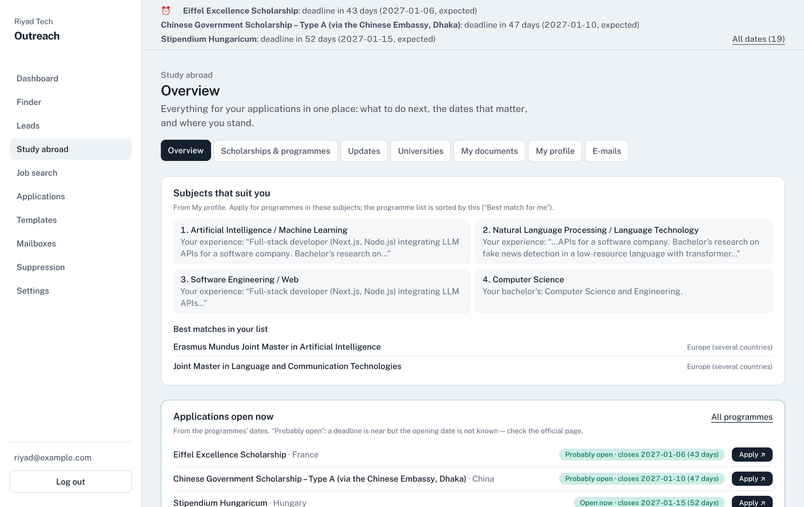
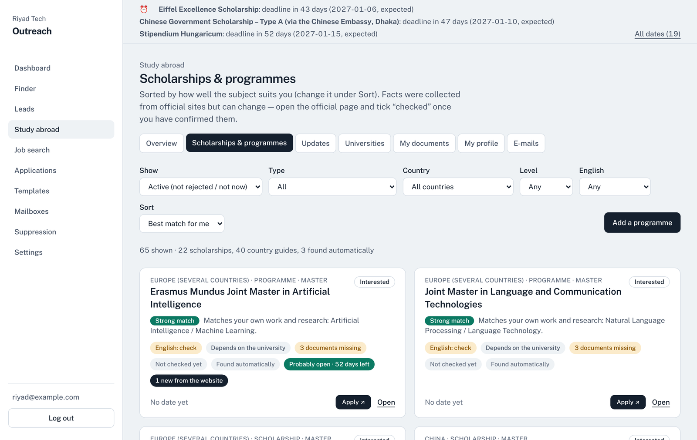
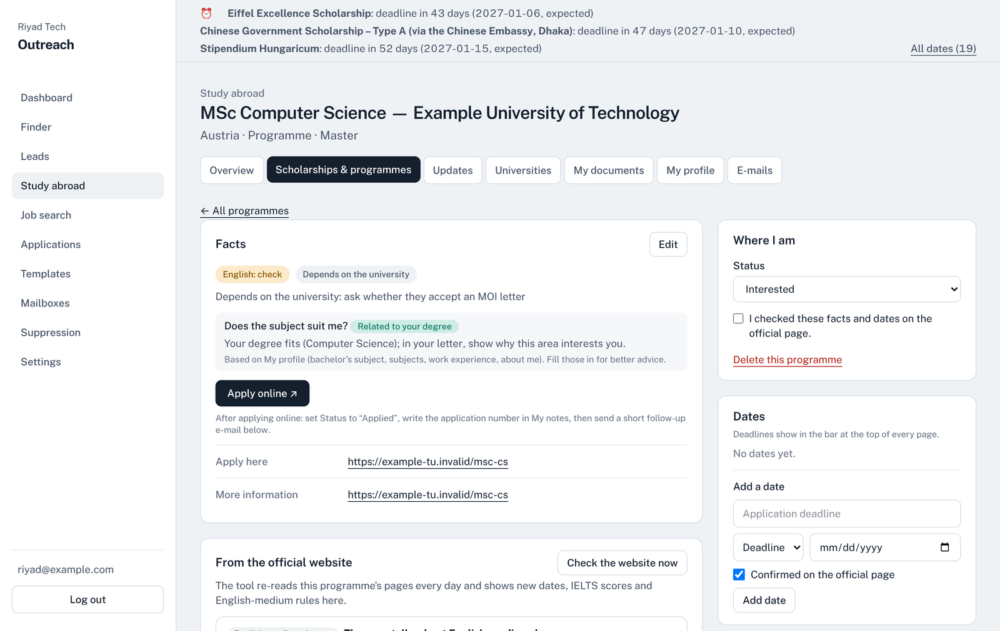
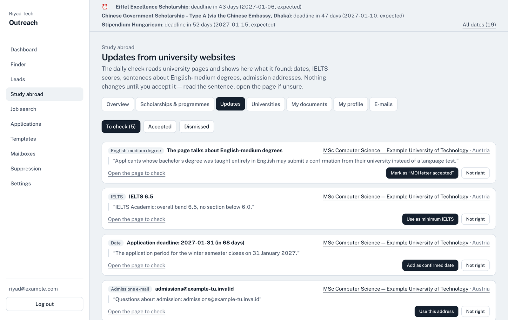
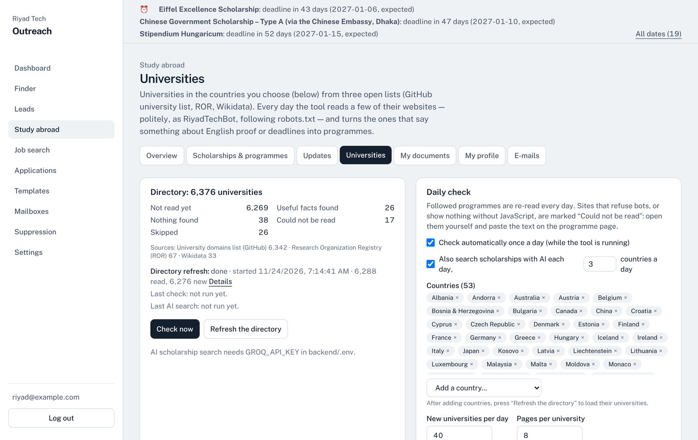
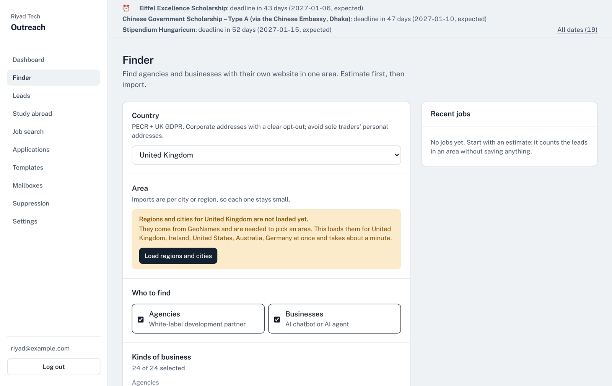
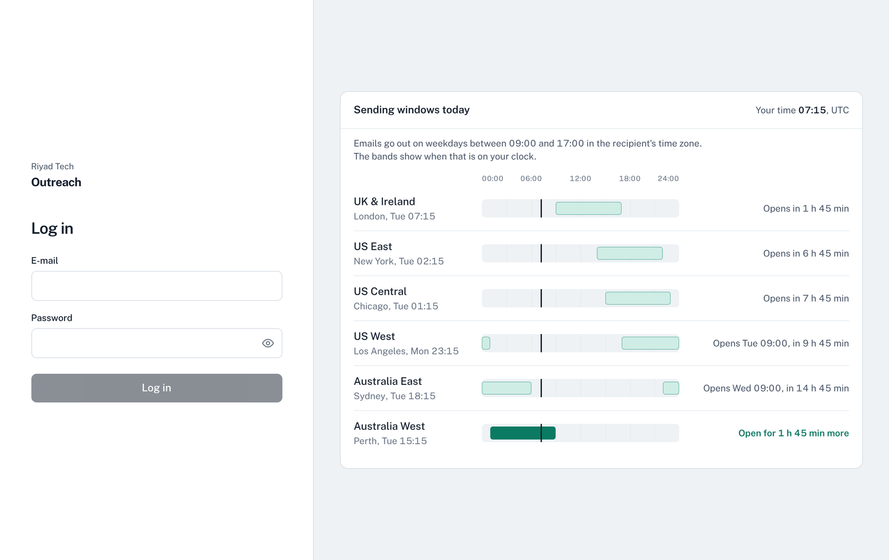
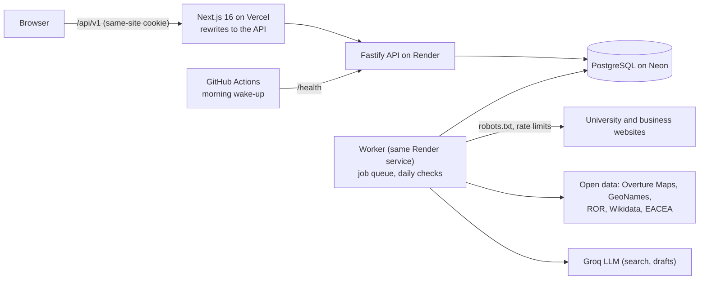

# Riyad Tech Outreach

A full-stack tool I built for two jobs: finding and contacting business clients for my freelance
studio (Riyad Tech), and planning my own master's applications abroad. It finds companies from
open map data, reads their websites politely, manages leads and mail, and keeps a live,
self-updating list of scholarships and university programmes matched to my profile.

**Stack:** TypeScript · Node.js 22/24 · Fastify 5 · Prisma 7 · PostgreSQL (Neon) · Next.js 16 · React 19 ·
Tailwind CSS 4 · TanStack Query · Vitest · Playwright · Groq (LLM) · Render + Vercel + Cloudflare



## How to look at this project

The live instance holds my own data and personal documents, so it is behind a login.
There are three ways to see it:

1. **Screenshots** below. They show the real app, filled with made-up demo data
   (`npm run seed:demo`).
2. **Run it locally in about 10 minutes** with a free Neon database. See [Run it locally](#run-it-locally).
   The demo script fills it with a sample student, so every page has something to show.
3. **Live walkthrough on request.** Contact me through the e-mail on my CV or my GitHub profile,
   and I can share my screen or give you a demo login on a separate database.

## What it does

### Study abroad planner

| Feature | How it works |
| --- | --- |
| **University directory** (6,000+ universities in 53 countries) | Merged by domain from three open sources: the Hipo university list (GitHub), the Research Organization Registry API and Wikidata SPARQL. Refreshed monthly. The import is resumable: each country is saved as soon as it is read, so a restart continues where it stopped. |
| **Daily website check** | A background worker reads a few university sites a day as an honest bot (`RiyadTechBot`). It respects robots.txt and crawl-delay, and never disguises itself. It extracts IELTS minimums, "English-medium degree accepted" rules, future application deadlines and admission e-mails, and detects changes through fact signatures. |
| **Human-in-the-loop findings** | Nothing changes on its own. Each finding shows the exact sentence and a link to its source page. Accepting a deadline creates a confirmed date, and accepting an IELTS score or an English-medium rule updates the programme. |
| **Official catalogues** | Reads the EACEA Erasmus Mundus catalogue (189 fully funded joint masters) and filters it to programmes close to Computer Science. |
| **Subject fit** | Rule-based and explainable. It reads topics from my degree, work experience and research, then grades each programme as strong match, related, weak or any subject, with the reason and warnings (CGPA minimum, years of work experience). |
| **"Applications open now"** | Built from confirmed and expected dates: open, probably open, or opening soon, each with a direct **Apply** link. |
| **AI scholarship search** | Groq `gpt-oss-120b` with built-in browser search proposes official pages. The tool then opens each page itself and keeps only those that really name the scholarship. Aggregators and home pages are rejected. |
| **Motivation letters** | One statement of purpose per programme. The AI writes a first draft from the profile and my own notes only, and anything it cannot know becomes a visible [[gap]] to fill in. I edit the draft, then print it or save it as a PDF. |
| **Documents and e-mails** | A checklist of documents per programme (a completion letter counts as the degree certificate until the certificate arrives), plus AI-drafted, editable follow-up e-mails sent from my own university mailbox with attachments. |

### Client outreach

| Feature | How it works |
| --- | --- |
| **Lead finder** | Queries Overture Maps places for one city or region using only HTTP range requests on remote Parquet files (STAC catalog, row-group bounding boxes), so no full-dataset download is needed. Areas come from GeoNames. |
| **Website crawler** | Same polite crawler: robots.txt, rate limits, and SSRF-safe DNS (private addresses blocked). It finds business e-mail addresses, technology signals and job ads (ATS detection). |
| **Leads, lists, suppression** | CSV import and export, lists, a suppression list and signed unsubscribe links. Country rules (e.g. PECR/UK GDPR) are shown where you pick the area. |
| **Mail** | SMTP/IMAP mailboxes with passwords encrypted using AES-256-GCM, warm-up limits per day, sending windows in the recipient's time zone, and plain-language DNS checks (MX, SPF, DKIM, DMARC). Sending is **off by default** (`SENDING_ENABLED=false`). |
| **Job search** | Public job APIs (Bundesagentur für Arbeit, Arbeitnow) for developer roles, plus tracking of my own job applications. |

## Screenshots

| | |
| --- | --- |
|  |  |
| **Programmes** sorted by how well the subject suits the profile | **Programme page**: subject fit, apply link, dates, findings |
|  |  |
| **Updates**: each finding with its source sentence | **Universities**: directory, daily check, countries |
|  |  |
| **Finder**: businesses with their own website in one area | **Login** |

## Architecture



- **One process, two roles.** `dist/all.js` supervises the API and the worker. If either stops,
  both exit and Render restarts the service.
- **Postgres job queue.** Jobs and tasks use `FOR UPDATE SKIP LOCKED` with group limits,
  pause/cancel, retries, stale-task recovery and heartbeats. There is no Redis.
- **Free-tier engineering.** The service keeps itself awake from 09:00 to 20:00 (Dhaka) by
  requesting its own `/health`, and a GitHub Actions schedule wakes it in the morning. Outside
  those hours it sleeps, so the database stays inside Neon's 100 compute-hours a month.
  The trade-offs are written up in `backend/docs/decisions.md`.
- **Mail on a free host.** Render's free plan blocks SMTP, so the hosted tool queues e-mails in an
  outbox table, and `npm run mail:outbox` on my PC sends them through the mailbox's own SMTP
  server and writes back the result. Each message is claimed once, so nothing is sent twice.
- **Security.** Single admin with bcrypt password hashing (cost 12), an HttpOnly JWT cookie, a CSRF header,
  login rate limiting and strict CORS. Secrets live only in environment variables. Mailbox
  passwords are encrypted at rest. In production, the app refuses to start with placeholder secrets.

## Quality

- **About 290 automated tests.** Backend unit tests run with no network and no database.
  Integration tests run against a real PostgreSQL. There are also frontend unit tests, and
  Playwright end-to-end checks are used while developing.
- **Strict TypeScript** with zod validation on every route and every environment variable,
  plus ESLint.
- **Decision log.** Every non-obvious choice is recorded with its reason, in
  [`backend/docs/decisions.md`](backend/docs/decisions.md) and
  [`frontend/docs/decisions.md`](frontend/docs/decisions.md).

## Run it locally

You need Node.js 22.13+ and a free [Neon](https://neon.com) PostgreSQL database (or any
PostgreSQL 15+).

```bash
# 1. Backend
cd backend
cp .env.example .env        # Windows: copy .env.example .env
#    Fill in DATABASE_URL / DIRECT_URL, JWT_SECRET, ENCRYPTION_KEY and ADMIN_EMAIL
#    (.env.example explains each one and how to generate the secrets)
npm install
npm run db:migrate
npm run seed:admin          # asks for the admin password (hidden)
npm run seed:demo           # optional: demo student, programmes and findings
npm run dev:all             # API + worker on http://127.0.0.1:4000

# 2. Frontend (second terminal)
cd frontend
cp .env.example .env.local
npm install
npm run dev                 # http://localhost:3000
```

Log in with the admin e-mail and password you set. No API key is needed to look around: the
Groq key (AI search and drafts) is optional, and e-mail sending stays off unless you turn it on.

Tests:

```bash
cd backend && npm run check        # typecheck + lint + unit tests
cd backend && npm run test:int     # integration tests (needs TEST_DATABASE_URL in .env)
cd frontend && npm run check
```

## Repository layout

```
backend/    Fastify API, worker, Prisma schema and migrations, seeds, tests, docs/decisions.md
frontend/   Next.js app (App Router), components, API client, docs/decisions.md
docs/       Screenshots for this README
.github/    Morning wake-up workflow for the hosted backend
```

## Responsible use

The crawler identifies itself, obeys robots.txt and crawl-delay, and rate-limits itself.
It does not bypass bot protection or CAPTCHAs, and it does not scrape LinkedIn, Facebook,
Instagram, Google Maps or Clutch. Outreach mail is limited by a warm-up schedule, honours an
unsubscribe link and a suppression list, and nothing is sent unless sending is explicitly enabled.

Data: Overture Maps Foundation (CDLA Permissive 2.0), GeoNames (CC BY 4.0), ROR (CC0),
Wikidata (CC0), Hipo university list (MIT).

## Author

**Md. Naymur Rahman (Riyad)**: BSc in Computer Science and Engineering, Daffodil International
University. AI-driven full-stack developer.
GitHub: [@rahman2220510189](https://github.com/rahman2220510189)
